<!-- Este README segue o template de referência do Prof. Dr. João Paulo Aramuni -->

---

# 🚗 DriveJá — Sistema de Aluguel de Carros 👨‍💻

<p align="center">
  
</p>

> [!NOTE]
> Plataforma web para **gestão de aluguéis de automóveis**: clientes criam, modificam, consultam e cancelam pedidos; agentes (bancos e empresas) analisam financeiramente os pedidos e, no caso dos bancos, concedem o contrato de crédito.

<table>
  <tr>
    <td width="800px">
      <div align="justify">
        O <b>DriveJá</b> (Sistema de Aluguel de Carros) foi desenvolvido para o <b>Laboratório 02</b> da disciplina de <i>Desenvolvimento e Integração de Aplicações Web (DIAW)</i>, do curso de <b>Engenharia de Software da PUC Minas</b>. Ele permite que <i>clientes</i> solicitem o aluguel de automóveis pela Internet e que <i>agentes</i> (empresas e bancos) avaliem esses pedidos do ponto de vista financeiro, modifiquem-nos durante a análise e, em caso de parecer positivo, executem o contrato, podendo associá-lo a um <b>contrato de crédito</b> concedido por um banco. O acesso é restrito a usuários cadastrados, mediante <b>login com usuário e senha</b>. O back-end é construído com <b>Spring Boot (arquitetura MVC)</b>, o front-end com <b>React + Vite</b> e a persistência usa <b>PostgreSQL hospedado no Supabase</b>.
      </div>
    </td>
    <td>
      <div>
        
      </div>
    </td>
  </tr> 
</table>

---

## 🚧 Status do Projeto

🟡 **Protótipo funcional (Laboratório 02)** — autenticação, CRUD de clientes e de automóveis, gestão de pedidos (criar, modificar, cancelar, avaliar) e geração de contrato de crédito estão implementados.

### Badges básicos:

[](https://github.com/diegovitorportella/diaw-lab02-aluguel-carros)
[](https://github.com/diegovitorportella/diaw-lab02-aluguel-carros)


### Stack:

        

---

## 📚 Índice
- [Links Úteis](#-links-úteis)
- [Sobre o Projeto](#-sobre-o-projeto)
- [Funcionalidades Principais](#-funcionalidades-principais)
- [Tecnologias Utilizadas](#-tecnologias-utilizadas)
- [Arquitetura](#-arquitetura)
  - [Diagramas](#diagramas)
- [Instalação e Execução](#-instalação-e-execução)
  - [Pré-requisitos](#pré-requisitos)
  - [Variáveis de Ambiente](#-variáveis-de-ambiente)
     - [1 Back-end (Spring Boot)](#1-back-end-spring-boot)
     - [2 Front-end (React, Vite)](#2-front-end-react-vite)
  - [Instalação de Dependências](#-instalação-de-dependências)
    - [Front-end (React)](#front-end-react)
    - [Back-end (Spring Boot)](#back-end-spring-boot)
  - [Inicialização do Banco de Dados (PostgreSQL / Supabase)](#-inicialização-do-banco-de-dados-postgresql--supabase)
  - [Como Executar a Aplicação](#-como-executar-a-aplicação)
    - [Terminal 1: Back-end (Spring Boot)](#terminal-1-back-end-spring-boot)
    - [Terminal 2: Front-end (React, Vite)](#terminal-2-front-end-react-vite)
    - [Contas de demonstração](#contas-de-demonstração)
- [Deploy](#-deploy)
- [Estrutura de Pastas](#-estrutura-de-pastas)
- [Demonstração](#-demonstração)
  - [Aplicação Web](#-aplicação-web)
  - [Exemplo de saída no Terminal (API)](#-exemplo-de-saída-no-terminal-api)
- [Testes](#-testes)
- [Documentações utilizadas](#-documentações-utilizadas)
- [Autores](#-autores)
- [Contribuição](#-contribuição)
- [Agradecimentos](#-agradecimentos)
- [Licença](#-licença)

---

## 🔗 Links Úteis
* 🌐 **Repositório:** [diegovitorportella/diaw-lab02-aluguel-carros](https://github.com/diegovitorportella/diaw-lab02-aluguel-carros)
  > 💻 **Descrição:** Código-fonte do back-end, do front-end e todas as versões dos modelos UML.
* 🎨 **Protótipo de telas (Figma):** [Car Rental Financing System](https://www.figma.com/make/5kRALrPP00TVaS4spzTls3/Car-Rental-Financing-System?t=f2NcPNTKBJAmMOxK-1)
  > 🖼️ **Descrição:** Protótipo visual que originou as telas do sistema. Detalhes em [`docs/prototipo.md`](./docs/prototipo.md).
* 📖 **Documentação de modelagem:** pasta [`docs/`](./docs)
  > 📚 **Descrição:** [Diagrama de Casos de Uso](./docs/Diagrama%20de%20Casos%20de%20Uso.pdf), [Diagrama de Classes](./docs/Diagrama%20de%20Classes.pdf), [Diagrama de Pacotes](./docs/Diagrama%20de%20Pacotes%20UML.pdf) e [Histórias de Usuário](./docs/historias_de_usuario.md).

* 🚀 **Aplicação publicada:** [driveja-zeta.vercel.app](https://driveja-zeta.vercel.app)
  > 🧪 **Descrição:** Front-end na Vercel, back-end no Render e banco no Supabase. A tela de login tem botões de acesso às contas de demonstração (cliente, banco e empresa). Detalhes em [Deploy](#-deploy).

---

## 📝 Sobre o Projeto

**Por que existe:** o laboratório propõe o desenvolvimento de um sistema de apoio à gestão de aluguéis de automóveis que permita **efetuar, cancelar e modificar pedidos através da Internet**, integrando clientes, empresas e bancos.

**Qual problema resolve:** centraliza em um único sistema o ciclo de vida de um pedido de aluguel — da solicitação do cliente à análise financeira feita pelos agentes e à execução do contrato, com ou sem financiamento.

**Contexto:** projeto **acadêmico** (PUC Minas — Engenharia de Software, disciplina DIAW, Prof. João Paulo Carneiro Aramuni), avaliado por: adequação aos requisitos, alinhamento entre modelos (classes e arquitetura) e código, e atualização dos modelos ao longo do projeto.

**Como funciona:**
- Só usuários **cadastrados e autenticados** utilizam o sistema.
- **Clientes** introduzem, modificam, consultam e cancelam pedidos de aluguel. Seus dados incluem RG, CPF, nome, endereço, profissão e até **3 entidades empregadoras com os respectivos rendimentos**.
- **Agentes** (empresas e bancos) avaliam financeiramente os pedidos, podem registrar observações durante a análise (veículo e datas são do cliente) e, havendo parecer positivo, executam o contrato.
- O aluguel pode estar associado a um **contrato de crédito**, concedido por um **banco** agente.
- Os automóveis (matrícula, ano, marca, modelo, placa) pertencem a um proprietário que pode ser um **cliente, uma empresa ou um banco**.

> [!NOTE]
> O sistema pode ser visto como dois subsistemas: **gestão de pedidos e contratos** (back-end/API) e **construção dinâmica das páginas web** (front-end React).

---

## ✨ Funcionalidades Principais

- 🔐 **Autenticação e autorização:** login com usuário e senha (BCrypt) que devolve um **token JWT**; toda a API (exceto login e autocadastro) exige o token e é restrita por perfil (`CLIENTE`, `BANCO`, `EMPRESA`). A identidade vem do token, nunca de parâmetros da requisição.
- 📝 **Autocadastro:** a tela de login tem o link *Cadastre-se* para o cliente criar a própria conta.
- 👤 **CRUD de Clientes:** cadastro com RG, CPF, nome, endereço, profissão e de **1 a 3 fontes de renda** (empregador + rendimento mensal), com **CPF validado pelos dígitos verificadores** (máscara no formulário, único no sistema) e login único.
- 🚘 **CRUD de Automóveis:** matrícula, ano, marca, modelo, **placa** (padrão antigo ou Mercosul, única), **valor da diária** e proprietário (cliente, empresa ou banco). O proprietário edita e exclui os próprios veículos pela tela.
- 📋 **Gestão de Pedidos (Cliente):** criar, **modificar** e **cancelar** pedidos e acompanhar cada um em uma **linha do tempo** (Solicitado → Aprovado → Concluído) com histórico de quem fez o quê e quando. O cliente não aluga o próprio veículo.
- 🧾 **Gestão de Pedidos (Agente):** três abas — **Em análise** (registrar observação e dar o parecer: positivo → `APROVADO`, negativo → `REJEITADO`) **Aguardando contrato** (executar o contrato → `CONCLUIDO`) e **Histórico** (análises já encerradas — concluídas, rejeitadas e canceladas — com filtro por situação, "somente as minhas análises", quem analisou, parecer e financiamento).
- 💰 **Simulação de valor do aluguel:** ao escolher o veículo e o período, a tela mostra ao vivo "N diárias × R$ diária = R$ total"; o back-end recalcula e grava o `valorTotal` (período inclusivo: de 10 a 12 são 3 diárias).
- 🏦 **Contrato de crédito com simulação:** ao executar o contrato, o banco informa entrada, nº de parcelas e juros (% a.a.) e vê a **parcela pela tabela Price**, o total pago e o **comprometimento da renda** do cliente, com **alerta acima de 30%**. O contrato guarda valor financiado, entrada, parcelas, juros e valor da parcela.
- ✅ **Validações por campo:** cada campo inválido recebe sua mensagem (no formulário e na API, que devolve `campos`), além das regras de negócio.
- 🔔 **Notificações internas:** o sino do cabeçalho lista decisões sobre os pedidos do cliente ou pedidos aguardando análise para o agente.
- ⚙️ **Configurações:** dados da conta e encerramento de sessão.
- 🛡️ **Regras de negócio e tratamento de erros:** respostas JSON padronizadas (`400`, `403`, `404`, `409`) com a mensagem do erro.

### Ciclo de vida de um pedido

```
        (parecer positivo)          (agente executa o contrato)
PENDENTE ───────────────▶ APROVADO ───────────────────────────▶ CONCLUIDO
   │                         │
   ├─(parecer negativo)─▶ REJEITADO
   └─(cliente cancela)──▶ CANCELADO ◀─(cliente cancela, enquanto sem contrato)
```

- **Modificar:** somente enquanto `PENDENTE`. O cliente dono altera veículo, datas e observação (recalcula o valor total); o agente altera apenas a observação (tentar mudar datas ou veículo retorna `403`).
- **Cancelar:** somente o cliente dono, se `PENDENTE` ou `APROVADO`.
- **Avaliar:** somente agentes, somente pedidos `PENDENTE`. **Aprovar não gera contrato.**
- **Executar contrato:** somente agentes, somente pedidos `APROVADO`; leva o pedido a `CONCLUIDO`. Com financiamento, somente banco.
- Cada mudança fica registrada no **histórico** do pedido (status, descrição, data/hora e responsável).

### Regras de validação

| Campo | Regra |
|---|---|
| **CPF** | 11 dígitos com dígitos verificadores corretos; único; gravado só com dígitos |
| **RG** | Obrigatório, de 5 a 14 caracteres alfanuméricos |
| **Nome, endereço, profissão** | Obrigatórios (nome com pelo menos 3 caracteres) |
| **Senha** | Mínimo de 8 caracteres |
| **Fontes de renda** | De 1 a 3; cada uma com empregador e rendimento **maior que zero**; mesma quantidade de empregadores e rendimentos |
| **Placa** | `ABC-1234` ou `ABC1D23` (Mercosul); única |
| **Ano do veículo** | De 1900 até o ano atual + 1 |
| **Valor da diária** | Maior que zero (até R$ 100.000,00) |
| **Pedido** | Veículo e datas obrigatórios; data inicial não pode ser anterior a hoje; data final não pode ser anterior à inicial; não se aluga o próprio veículo |
| **Financiamento** | 1 a 120 parcelas; juros de 0 a 200% a.a.; entrada ≥ 0; valor financiado ≤ valor total do pedido |

---

## 🛠 Tecnologias Utilizadas

### 💻 Front-end

* **Framework/Biblioteca:** React 19
* **Linguagem/Superset:** TypeScript
* **Estilização:** Tailwind CSS v4
* **Gerenciamento de Estado:** estado local com hooks (`useState`/`useEffect`)
* **Comunicação com a API:** Fetch API (camada em `src/services/api.ts`)
* **Build Tool:** Vite 8

### 🖥️ Back-end

* **Linguagem/Runtime:** Java 25 (JDK)
* **Framework:** Spring Boot 4.0.9 (Spring Web MVC)
* **Build e dependências:** Apache Maven (Maven Wrapper)
* **Banco de Dados:** PostgreSQL hospedado no **Supabase**
* **ORM:** Spring Data JPA / Hibernate (herança `JOINED`, `ddl-auto=update`)
* **Autenticação e autorização:** Spring Security, tokens **JWT** (Bearer, stateless) e senhas com hash **BCrypt**

### ⚙️ Infraestrutura & DevOps

* **Banco gerenciado:** Supabase (PostgreSQL)
* **Controle de versão:** Git + GitHub, commits no padrão Conventional Commits

---

## 🏗 Arquitetura

O back-end segue a **arquitetura MVC em camadas** do Spring Boot; o front-end React consome a API REST por HTTP/JSON.

```
┌────────────────────┐   HTTP / JSON    ┌──────────────────────────────────────────┐   JDBC   ┌──────────────────┐
│  Front-end (React) │ ───────────────▶ │            Back-end (Spring Boot)        │ ───────▶ │ PostgreSQL       │
│  pages/components  │ ◀─────────────── │ Controller → Service → Repository → Model │ ◀─────── │ (Supabase)       │
└────────────────────┘                  └──────────────────────────────────────────┘          └──────────────────┘
```

**Principais componentes (Visão Lógica / pacotes `com.example.demo`):**

| Pacote | Papel |
| :--- | :--- |
| `controller` | Endpoints REST (`/api/auth`, `/api/clientes`, `/api/automoveis`, `/api/pedidos`, `/api/contratos`). |
| `service` | Regras de negócio (fontes de renda, ciclo de vida e histórico do pedido, valor total, contrato, simulação Price, autenticação). |
| `repository` | Acesso a dados com Spring Data JPA. |
| `model` | Entidades JPA: `Usuario` (abstrata) → `Cliente`, `Agente` (abstrata) → `Banco`, `Empresa`; `Automovel`, `PedidoAluguel`, `Contrato` → `ContratoCredito`. |
| `dto` | Objetos de transferência (`LoginDTO`, `LoginResponseDTO`, `AutomovelDTO`, `PedidoDTO`, `ContratoCreditoDTO`, `SimulacaoDTO`, `IdRefDTO`). |
| `exception` | Exceções de negócio, `ValidacaoException` (erros por campo) e `GlobalExceptionHandler` (respostas JSON de erro). |
| `validation` | `Validadores`: CPF (dígitos verificadores), RG e placa. |
| `security` | `SecurityConfig` (regras de acesso, CORS, BCrypt, chave JWT) e `JwtService` (emissão do token). |
| `config` | Carga de agentes de demonstração (`DataInitializer`, somente perfil `dev`). |

**Padrões e decisões:**
- **Herança `JOINED`** para `Usuario`/`Agente`/`Contrato`: um proprietário de automóvel ou um avaliador pode ser de tipos diferentes sem duplicar tabelas.
- **DTOs na entrada:** referências a entidades chegam como `{ "id": n }` e o *service* busca a entidade real antes de associá-la (evita erro ao desserializar tipos abstratos como `Usuario`). O cliente de um pedido, o proprietário de um automóvel e o banco de um crédito são sempre o **usuário autenticado**.
- **Sem recursão no JSON:** a associação bidirecional `PedidoAluguel ↔ Contrato` usa `@JsonIgnoreProperties`; a senha é `WRITE_ONLY` e nunca sai na API.
- **Campo `tipo`** exposto no usuário (`CLIENTE`/`BANCO`/`EMPRESA`) para o front-end decidir telas e permissões.

### Segurança

- **Senhas:** armazenadas com **BCrypt**. Contas antigas em texto puro são aceitas uma única vez no login e migradas automaticamente para hash.
- **Sessão:** JWT assinado (HS256) com expiração de 8 h, enviado no header `Authorization: Bearer <token>`; sem sessão no servidor (stateless).
- **Autorização por perfil:** `CLIENTE` cria e cancela pedidos e vê apenas os próprios pedidos e contratos; `BANCO` e `EMPRESA` (papel `AGENTE`) listam clientes, avaliam pedidos e executam contratos; somente `BANCO` concede crédito; automóveis só são alterados/excluídos pelo proprietário.
- **Erros padronizados:** `401` (sem token/credenciais inválidas), `403` (sem permissão), `404`, `400` e `409` (regra de negócio), sempre com `{ "erro": "..." }`; falhas de validação (`400`) acrescentam `"campos": { "cpf": "CPF inválido." }`.

> [!NOTE]
> **Limitações (escopo de laboratório):** não há recuperação de senha, bloqueio por tentativas nem *refresh token*, e o front-end guarda o token apenas em memória (recarregar a página encerra a sessão).

### Diagramas

Os modelos UML produzidos ao longo do projeto ficam em [`docs/`](./docs):

| Diagrama | Arquivo |
| :--- | :--- |
| Casos de Uso | [`Diagrama de Casos de Uso.pdf`](./docs/Diagrama%20de%20Casos%20de%20Uso.pdf) |
| Classes | [`Diagrama de Classes.pdf`](./docs/Diagrama%20de%20Classes.pdf) |
| Pacotes (Visão Lógica) | [`Diagrama de Pacotes UML.pdf`](./docs/Diagrama%20de%20Pacotes%20UML.pdf) |
| Histórias de Usuário | [`historias_de_usuario.md`](./docs/historias_de_usuario.md) |

Modelo de classes resumido, conforme implementado no código:

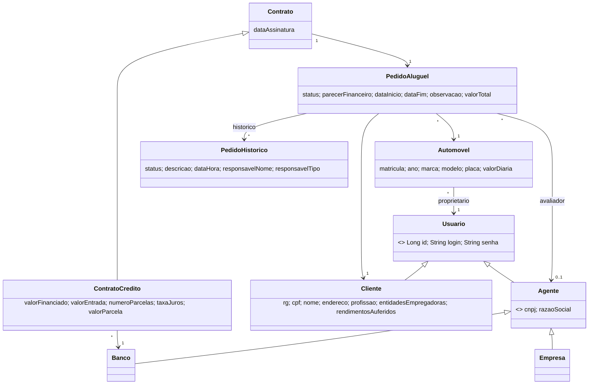

### API REST

Legenda de acesso: 🌐 público · 🔑 qualquer usuário autenticado · 👤 cliente · 🏦 agente (banco/empresa).

| Acesso | Método | Rota | Descrição |
| :---: | :--- | :--- | :--- |
| 🌐 | `POST` | `/api/auth/login` | Autentica com `{ login, senha }` e devolve `{ token, usuario }`. |
| 🔑 | `GET` | `/api/auth/me` | Dados do usuário dono do token. |
| 🌐 | `POST` | `/api/clientes` | Autocadastro de cliente (CPF/RG, 1 a 3 fontes de renda, login único, senha ≥ 8). |
| 🏦 | `GET` | `/api/clientes` | Lista clientes. |
| 🔑 | `GET` | `/api/clientes/{id}` | Dados de um cliente (o próprio ou, se agente, qualquer um). |
| 🔑 | `PUT` | `/api/clientes/{id}` | Atualiza cliente (o próprio ou agente); revalida os rendimentos. |
| 🔑 | `DELETE` | `/api/clientes/{id}` | Exclui cliente sem pedidos nem automóveis. |
| 🔑 | `POST` | `/api/automoveis` | Cadastra automóvel (placa única, valor da diária); o proprietário é o usuário autenticado. |
| 🔑 | `GET` | `/api/automoveis` | Lista todos os automóveis. |
| 🔑 | `GET` | `/api/automoveis/meus` | Lista os automóveis do usuário autenticado. |
| 🔑 | `GET` | `/api/automoveis/{id}` | Busca um automóvel. |
| 🔑 | `PUT` | `/api/automoveis/{id}` | Atualiza automóvel (somente o proprietário). |
| 🔑 | `DELETE` | `/api/automoveis/{id}` | Exclui automóvel sem pedidos (somente o proprietário). |
| 👤 | `POST` | `/api/pedidos` | Cria pedido (`PENDENTE`) com período e valor total calculado, para o cliente autenticado. |
| 🔑 | `GET` | `/api/pedidos?status=` | Cliente: os próprios pedidos. Agente: todos. Filtro opcional por status. |
| 🔑 | `GET` | `/api/pedidos/{id}` | Busca pedido (dono ou agente). |
| 🔑 | `PUT` | `/api/pedidos/{id}` | Modifica pedido pendente (cliente: veículo/datas/observação; agente: só observação). |
| 👤 | `PUT` | `/api/pedidos/{id}/cancelar` | Cancela pedido (cliente dono, se pendente ou aprovado sem contrato). |
| 🏦 | `PUT` | `/api/pedidos/{id}/avaliar?parecer=` | Avalia pedido pendente (`POSITIVO` → `APROVADO`, `NEGATIVO` → `REJEITADO`). |
| 🏦 | `GET` | `/api/pedidos/{id}/simulacao?parcelas=&juros=&entrada=&valorFinanciado=` | Simula o financiamento (tabela Price) e o comprometimento da renda do cliente. |
| 🏦 | `POST` | `/api/contratos/gerar/{pedidoId}` | Executa o contrato de pedido aprovado e o leva a `CONCLUIDO`. Com `{ valorEntrada, numeroParcelas, taxaJuros, valorFinanciado? }` (somente banco) gera `ContratoCredito`. |
| 🔑 | `GET` | `/api/contratos` | Cliente: contratos dos próprios pedidos. Agente: todos. |
| 🔑 | `GET` | `/api/contratos/{id}` | Busca contrato (dono do pedido ou agente). |

---

## 🔧 Instalação e Execução

### Pré-requisitos

* **Java JDK:** versão **25** (definida no `pom.xml`) — back-end Spring Boot
* **Node.js:** versão LTS (v20.x ou superior) — front-end React
* **Gerenciador de Pacotes:** npm
* **Conta no Supabase** (ou qualquer PostgreSQL acessível) para o banco de dados
* Maven **não** precisa estar instalado: o projeto usa o **Maven Wrapper** (`mvnw`)

---

### 🔑 Variáveis de Ambiente

#### 1 Back-end (Spring Boot)

O back-end ativa o perfil `dev` (`spring.profiles.active=dev`) e lê as credenciais do banco de `backend/src/main/resources/application-dev.properties`. **Esse arquivo não é versionado** (está no `.gitignore`): crie-o localmente com os dados da sua conexão do Supabase (*Project Settings → Database → Connection string*).

```properties
# backend/src/main/resources/application-dev.properties  (NÃO VERSIONAR)
spring.datasource.url=jdbc:postgresql://<host-do-supabase>:5432/postgres
spring.datasource.username=<usuario>
spring.datasource.password=<senha>
spring.datasource.driver-class-name=org.postgresql.Driver
```

| Propriedade | Descrição | Exemplo |
| :--- | :--- | :--- |
| `spring.datasource.url` | URL JDBC do PostgreSQL (Supabase). | `jdbc:postgresql://aws-0-us-east-1.pooler.supabase.com:5432/postgres` |
| `spring.datasource.username` | Usuário do banco. | `postgres.<id-do-projeto>` |
| `spring.datasource.password` | Senha do banco. | `********` |

Chave de assinatura dos tokens JWT (variável de ambiente ou propriedade):

| Variável | Descrição | Exemplo |
| :--- | :--- | :--- |
| `JWT_SECRET` | Chave HMAC do JWT, **mínimo de 32 caracteres**. Se não for definida, uma chave aleatória é gerada a cada execução (os tokens deixam de valer ao reiniciar o servidor). | `uma-chave-longa-e-aleatoria-com-32+-caracteres` |

> [!IMPORTANT]
> Nunca faça commit de senhas, chaves ou strings de conexão reais. Equivalentes em variáveis de ambiente do sistema também funcionam: `SPRING_DATASOURCE_URL`, `SPRING_DATASOURCE_USERNAME` e `SPRING_DATASOURCE_PASSWORD`.

#### 2 Front-end (React, Vite)

O front-end **não exige** arquivo `.env`. A URL da API está definida em `frontend/src/services/api.ts`:

```ts
const API_URL = 'http://localhost:8080/api';
```

Para apontar para outro servidor, altere essa constante. A API libera CORS para `http://localhost:5173` (Vite) e `http://localhost:8443` em `SecurityConfig.java`.

---

### 📦 Instalação de Dependências

1.  **Clone o Repositório:**

```bash
git clone https://github.com/diegovitorportella/diaw-lab02-aluguel-carros.git
cd diaw-lab02-aluguel-carros
```

#### Front-end (React)

```bash
cd frontend
npm install
cd ..
```

#### Back-end (Spring Boot)

```bash
cd backend
./mvnw clean install -DskipTests
cd ..
```

> No Windows (PowerShell/CMD) use `mvnw.cmd` no lugar de `./mvnw`.
> O `-DskipTests` evita que o teste de contexto tente conectar ao banco durante o build.

---

### 💾 Inicialização do Banco de Dados (PostgreSQL / Supabase)

1. Crie um projeto no [Supabase](https://supabase.com/) e copie os dados de conexão para o `application-dev.properties` (seção anterior).
2. **Não é necessário rodar scripts SQL:** o Hibernate está com `spring.jpa.hibernate.ddl-auto=update` e cria/atualiza as tabelas automaticamente na primeira execução do back-end (`usuario`, `cliente`, `agente`, `banco`, `empresa`, `automovel`, `pedido_aluguel`, `contrato`, `contrato_credito`, `cliente_empregadores`, `cliente_rendimentos`).
3. Na inicialização, o `DataInitializer` cria dois **agentes de demonstração** se ainda não existirem (veja [Contas de demonstração](#contas-de-demonstração)).

---

### ⚡ Como Executar a Aplicação
Execute em **dois terminais separados**.

#### Terminal 1: Back-end (Spring Boot)

```bash
cd backend
./mvnw spring-boot:run
```
🚀 *O Back-end estará disponível em **http://localhost:8080**.* Aguarde a mensagem `Started DemoApplication`.

---

#### Terminal 2: Front-end (React, Vite)

```bash
cd frontend
npm run dev
```
🎨 *O Front-end estará disponível em **http://localhost:5173**.*

---

#### Contas de demonstração

| Perfil | Usuário | Senha | Como é criada |
| :--- | :--- | :--- | :--- |
| Banco (agente) | `banco.agente` | `password123` | Automaticamente pelo `DataInitializer` (perfil `dev`), com senha em hash |
| Empresa (agente) | `empresa.agente` | `password123` | Automaticamente pelo `DataInitializer` |
| Cliente | *(à sua escolha)* | *(à sua escolha)* | Pela tela **Clientes** → *Cadastrar novo cliente* |

> [!WARNING]
> As contas de demonstração existem apenas para desenvolvimento. Remova o `DataInitializer` (ou troque as senhas) antes de qualquer uso fora do laboratório.

> 🐳 O projeto **não** utiliza Docker/Docker Compose: o banco é o PostgreSQL gerenciado do Supabase.

---

## 🚀 Deploy

Versão publicada: **https://driveja-zeta.vercel.app** (use os botões de demonstração na tela de login).

Arquitetura de publicação: **front-end na Vercel** (site estático), **back-end no Render** (contêiner Docker) e **banco no Supabase** (PostgreSQL).

### 1. Back-end no Render

1. No Render, crie um **Blueprint** a partir do repositório (usa o [`render.yaml`](render.yaml), que aponta para o [`backend/Dockerfile`](backend/Dockerfile)).
2. Preencha as variáveis de ambiente pedidas:

| Variável | Valor |
|---|---|
| `SPRING_DATASOURCE_URL` | URL JDBC do Supabase (pooler), ex.: `jdbc:postgresql://<host>:5432/postgres?sslmode=require` |
| `SPRING_DATASOURCE_USERNAME` / `SPRING_DATASOURCE_PASSWORD` | usuário e senha do banco |
| `SEED_SENHA` | senha dos agentes de demonstração `banco.agente` e `empresa.agente` |
| `CORS_ORIGINS` | URL do front-end na Vercel (várias separadas por vírgula) |
| `DEMO_ENABLED` | `true` cria as contas públicas `demo.cliente`, `demo.banco` e `demo.empresa` (senha `demo12345`) e um veículo de exemplo; use só na versão de exibição |
| `JWT_SECRET` | gerada automaticamente pelo Render |

O perfil `seed` (definido no blueprint) cria os agentes de demonstração com a senha de `SEED_SENHA`. Sem esse perfil não há como logar como banco ou empresa, pois não existe tela de cadastro de agentes.

### 2. Front-end na Vercel

1. Importe o repositório na Vercel com **Root Directory = `frontend`** (preset Vite).
2. Em *Settings → Environment Variables*, defina `VITE_API_URL` com a URL do back-end: `https://<servico>.onrender.com/api`.
3. Para mostrar os botões de acesso rápido às contas de demonstração na tela de login, defina também `VITE_MODO_DEMO=true`.
4. Depois do deploy, copie a URL da Vercel para `CORS_ORIGINS` no Render.

> O plano gratuito do Render hiberna o serviço após alguns minutos sem uso: a primeira chamada depois disso pode levar cerca de 1 minuto.

### Build manual

```bash
cd frontend && npm run build              # gera /dist
cd ../backend && ./mvnw clean package     # gera target/demo-0.0.1-SNAPSHOT.jar
java -jar target/demo-0.0.1-SNAPSHOT.jar  # exige as variáveis do banco e JWT_SECRET
```

---

## 📂 Estrutura de Pastas

```
.
├── .gitignore                    # 🧹 Ignora node_modules, target e application-dev.properties.
├── README.md                     # 📘 Documentação principal do projeto.
│
├── /backend                      # 📁 Aplicação Spring Boot (Maven)
│   ├── mvnw / mvnw.cmd           # 🛠️ Maven Wrapper.
│   ├── pom.xml                   # 📦 Build e dependências.
│   └── /src
│       ├── /main/java/com/example/demo
│       │   ├── DemoApplication.java
│       │   ├── /controller       # 🎮 Endpoints REST.
│       │   ├── /service          # ⚙️ Regras e lógica de negócio.
│       │   ├── /repository       # 🗄️ Repositórios (Spring Data JPA).
│       │   ├── /model            # 🧬 Entidades JPA.
│       │   ├── /dto              # ✉️ Data Transfer Objects.
│       │   ├── /exception        # 💥 Exceções e handler global.
│       │   ├── /security         # 🛡️ Spring Security, JWT e CORS.
│       │   └── /config           # 🔧 Dados de demonstração (perfil dev).
│       ├── /main/resources
│       │   ├── application.properties       # ⚙️ Configuração principal (JPA/Hibernate).
│       │   └── application-dev.properties   # 🔒 Credenciais do banco (NÃO versionado).
│       └── /test                 # 🧪 Testes unitários e de integração (H2 em memória).
│           ├── /java/com/example/demo
│           └── /resources/application.properties
│
├── /frontend                     # 📁 Aplicação React + Vite
│   ├── index.html
│   ├── package.json              # 📦 Dependências e scripts.
│   ├── vite.config.ts
│   ├── /public                   # 📂 Arquivos estáticos (favicon.png).
│   └── /src
│       ├── main.tsx / App.tsx    # 🚪 Entrada e controle de telas/usuário logado.
│       ├── /pages                # 📄 Login, ClientRegistration, Requests, FinancialReview, Vehicles, Settings.
│       ├── /components           # 🧱 Shell, Header, StatusBadge, TextInput, Field, Icon, Logo.
│       ├── /services             # 🔌 api.ts — chamadas HTTP ao back-end.
│       └── /assets               # 🖼️ Logos (logo.png, logo-light.png, icon.png).
│
└── /docs                         # 📚 Modelagem e protótipo
    ├── Diagrama de Casos de Uso.pdf
    ├── Diagrama de Classes.pdf
    ├── Diagrama de Pacotes UML.pdf
    ├── historias_de_usuario.md
    ├── prototipo.md
    └── /images                   # 🖼️ Logo e telas do protótipo.
```

---

## 🎥 Demonstração

### 🌐 Aplicação em funcionamento

Capturas da versão publicada, com dados de demonstração (link em [Links Úteis](#-links-úteis)).

| | |
| :---: | :---: |
| **Login com acesso de demonstração** | **Meus pedidos (cliente): pista do pedido e status** |
| 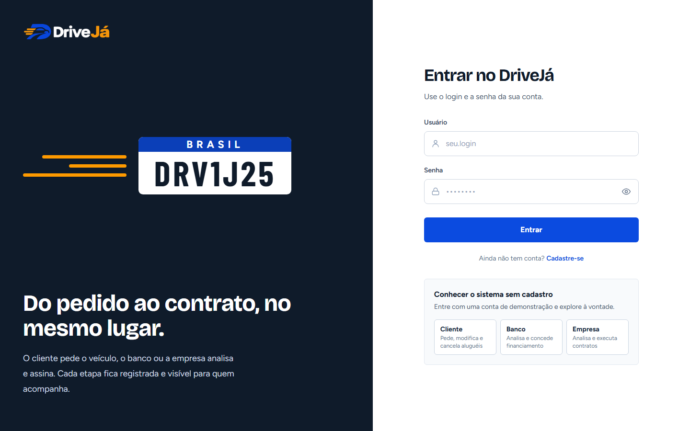 | 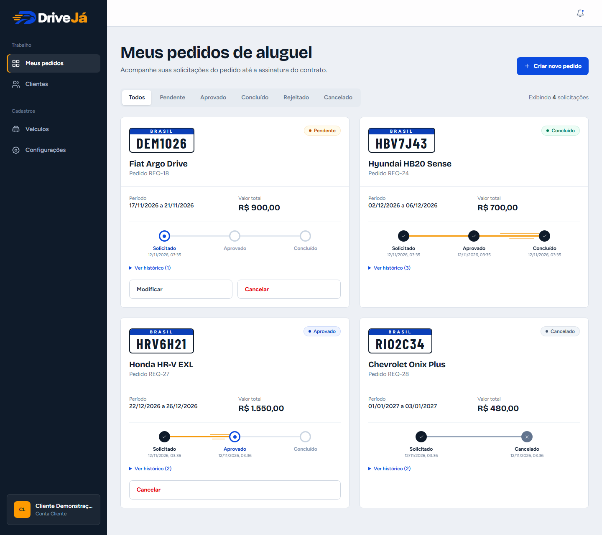 |
| **Veículos com placa Mercosul** | **Análise financeira: pedidos pendentes** |
| 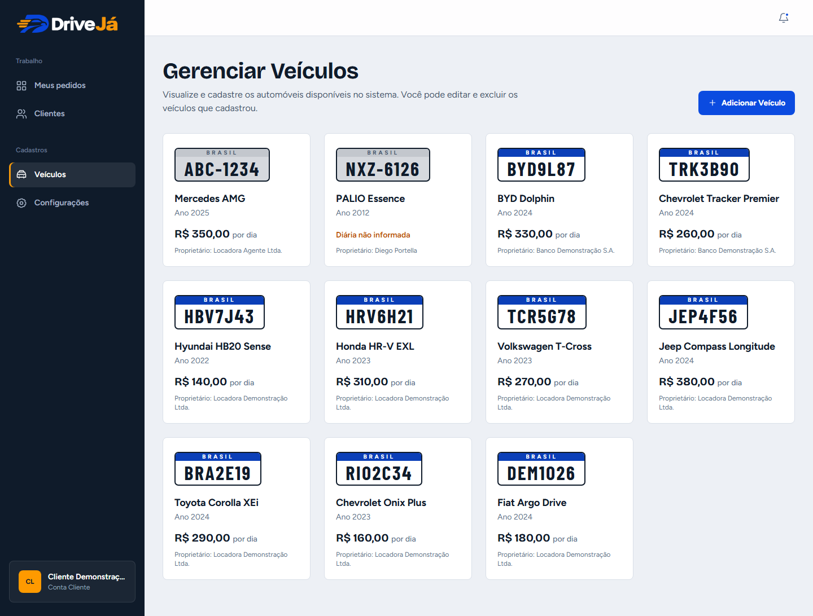 | 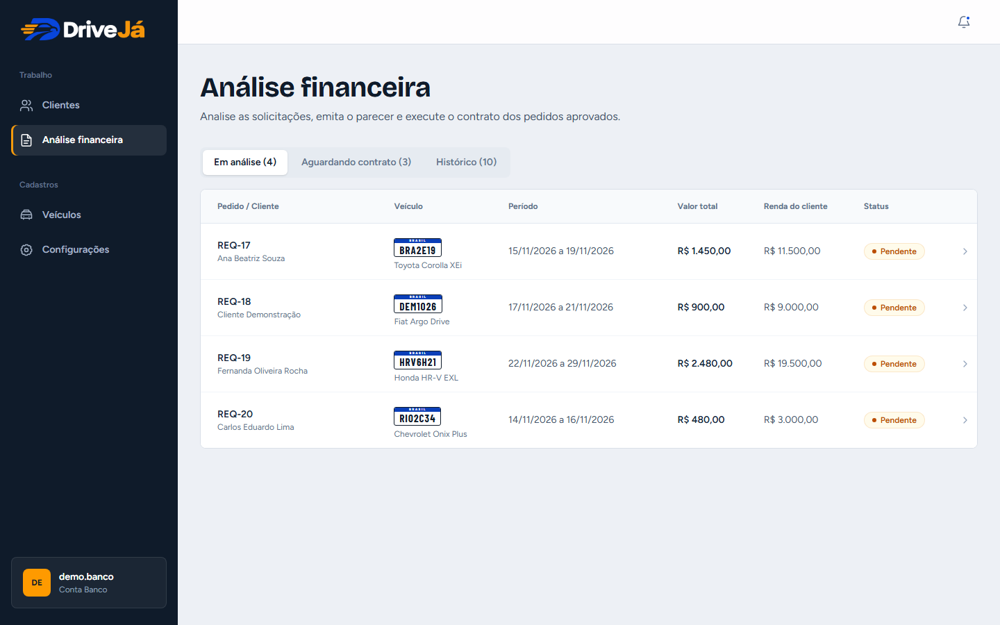 |
| **Execução do contrato com simulação (Price) e alerta de renda** | **Histórico de análises encerradas** |
| 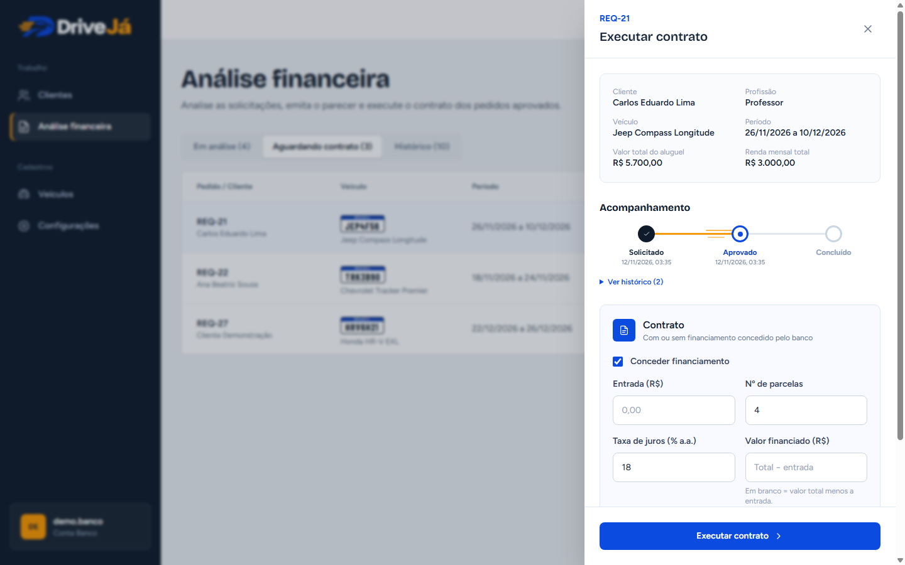 | 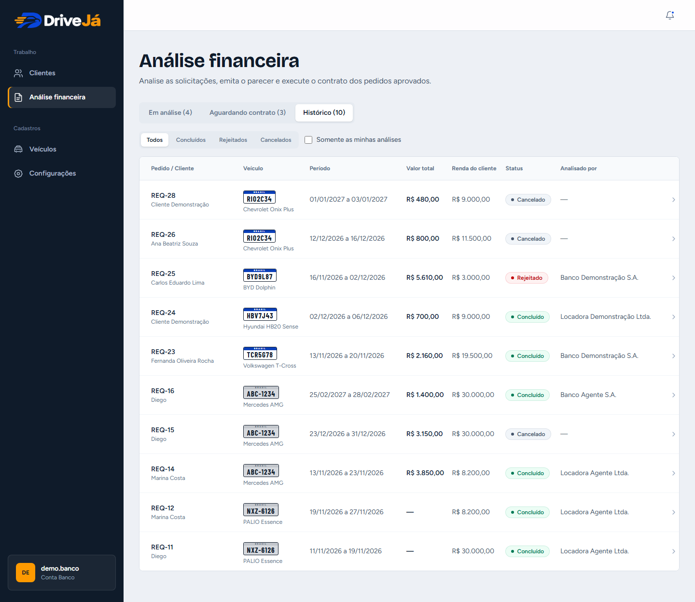 |

### 🎨 Protótipo inicial

Telas do protótipo que guiou a implementação (detalhes em [`docs/prototipo.md`](./docs/prototipo.md)):

| Tela | Captura de Tela |
| :---: | :---: |
| **Login** | **Cadastro de Clientes** |
| 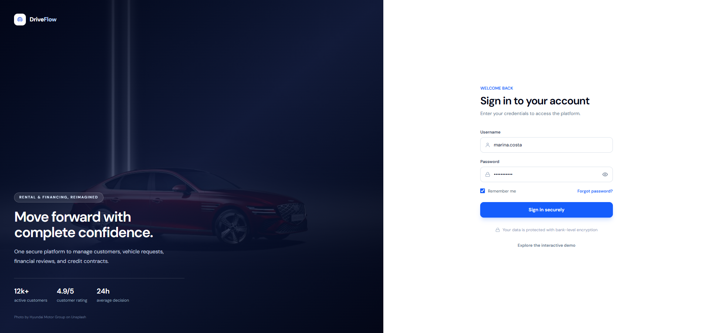 | 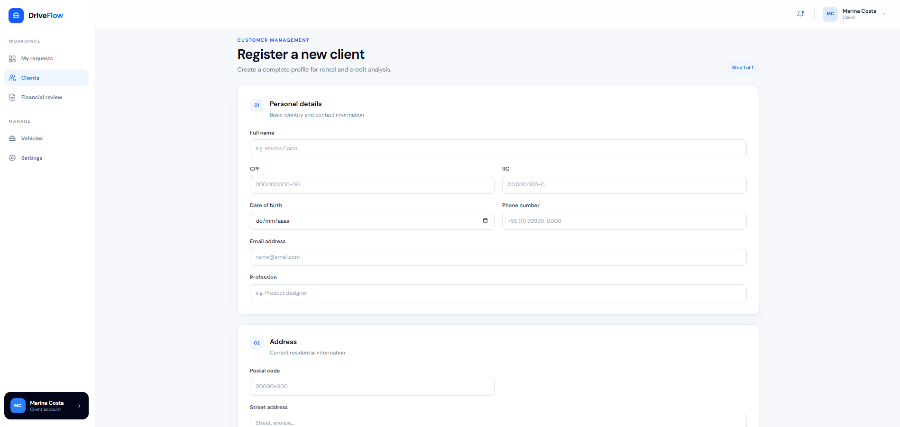 |
| **Meus Pedidos (Cliente)** | **Análise Financeira (Agente)** |
| 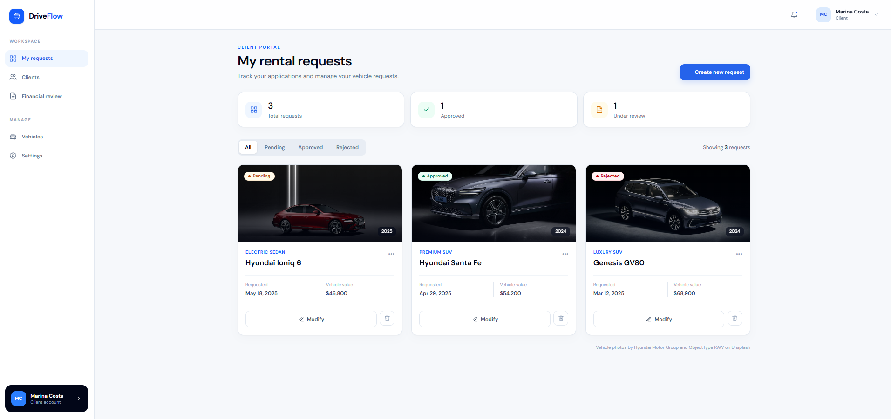 | 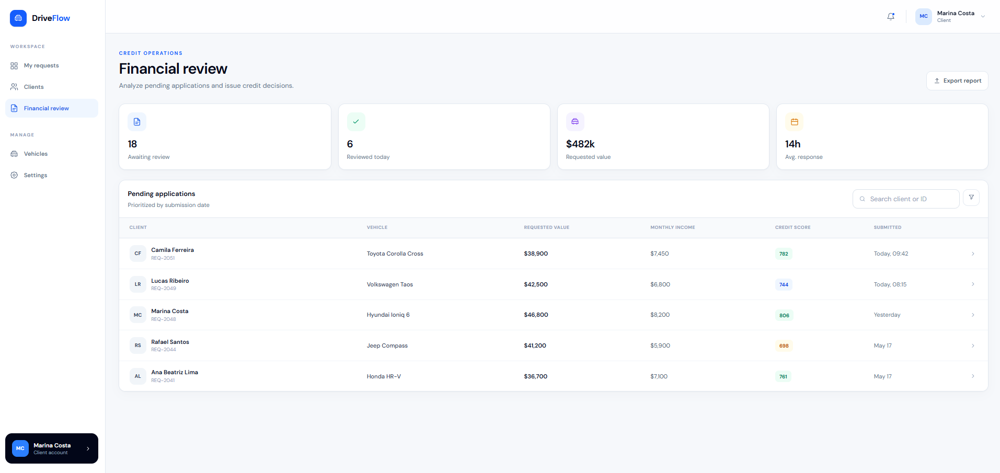 |

> Conforme a especificação do laboratório, o protótipo final deve ser comparado com os modelos iniciais e as modificações necessárias devem estar documentadas.

### 💻 Exemplo de Saída no Terminal (API)

#### 1. Login (agente) — devolve o token JWT

```bash
curl -X POST http://localhost:8080/api/auth/login \
     -H 'Content-Type: application/json' \
     -d '{"login":"banco.agente","senha":"password123"}'
```

**Saída Esperada** (a senha nunca é retornada):
```json
{
  "token": "eyJhbGciOiJIUzI1NiJ9...",
  "usuario": {
    "id": 2,
    "login": "banco.agente",
    "cnpj": "00.000.000/0001-00",
    "razaoSocial": "Banco Agente S.A.",
    "tipo": "BANCO"
  }
}
```

#### 2. Rota protegida sem token

```bash
curl -i http://localhost:8080/api/pedidos
```

**Saída Esperada:** `HTTP/1.1 401` (com o token: `Authorization: Bearer <token>` → `200`).

#### 3. Regra de negócio: máximo de 3 rendimentos

```bash
curl -i -X POST http://localhost:8080/api/clientes \
     -H 'Content-Type: application/json' \
     -d '{"login":"x","senha":"senha123","rendimentosAuferidos":[1,2,3,4]}'
```

**Saída Esperada:**
```text
HTTP/1.1 400
{"erro":"O cliente pode ter no máximo 3 rendimentos auferidos."}
```

#### 4. Fluxo do pedido até o contrato de crédito (como banco)

```bash
TOKEN=<token-do-banco>

# 1) Avaliar o pedido 1: apenas APROVA (o agente avaliador é o dono do token)
curl -X PUT 'http://localhost:8080/api/pedidos/1/avaliar?parecer=POSITIVO' \
     -H "Authorization: Bearer $TOKEN"

# 2) Simular o financiamento: entrada de R$ 100, 12 parcelas, 12% a.a.
curl 'http://localhost:8080/api/pedidos/1/simulacao?parcelas=12&juros=12&entrada=100' \
     -H "Authorization: Bearer $TOKEN"

# 3) Executar o contrato com crédito (o banco é o dono do token) -> pedido CONCLUIDO
curl -X POST http://localhost:8080/api/contratos/gerar/1 \
     -H "Authorization: Bearer $TOKEN" -H 'Content-Type: application/json' \
     -d '{"valorEntrada":100,"numeroParcelas":12,"taxaJuros":12}'
```

---

## 🧪 Testes

### Testes Unitários e de Integração
O back-end possui **131 testes automatizados** que rodam em **H2 em memória** (não usam o Supabase nem exigem configuração):

| Classe | Tipo | O que cobre |
| :--- | :--- | :--- |
| `ClienteServiceTest` | Unitário (Mockito) | CPF/RG, 1 a 3 fontes de renda, empregadores × rendimentos, login único, senha mínima e hash, permissões, atualização e exclusão. |
| `AutomovelServiceTest` | Unitário (Mockito) | Placa (formato, normalização e duplicidade), ano, valor da diária, propriedade e exclusão. |
| `PedidoAluguelServiceTest` | Unitário (Mockito) | Valor total, datas, veículo próprio, histórico, modificar, cancelar e avaliar (permissões e estados). |
| `ContratoServiceTest` | Unitário (Mockito) | Contrato simples × `ContratoCredito`, parcela Price, só banco concede crédito, conclusão do pedido, validações. |
| `SimulacaoServiceTest` | Unitário (Mockito) | Taxa mensal, parcela Price, alerta de 30% da renda e parâmetros. |
| `UsuarioServiceTest` | Unitário (Mockito) | Autenticação BCrypt, senha errada, migração de senha em texto puro. |
| `ValidadoresTest` | Unitário | CPF (dígitos verificadores), RG e placa. |
| `ApiIntegrationTest` | Integração (MockMvc) | API completa com Spring Security + JWT: `401`/`403`/`409`, erros por campo, CRUDs, simulação e fluxo pendente → aprovado → concluído com crédito e histórico. |

```bash
cd backend
./mvnw test
```

*Ferramentas utilizadas: JUnit 5, Mockito, Spring Boot Test, MockMvc e H2.*

### Verificação do Front-end

```bash
cd frontend
npx tsc -b        # checagem de tipos
npm run build     # build de produção
```

### Testes End-to-End (E2E) manuais
Com back-end e front-end em execução, valide o fluxo completo:

1. **Login** com credenciais inválidas (erro) e válidas (cliente cai em *Meus pedidos*; agente cai em *Análise financeira*).
2. **Cliente:** cadastrar cliente (CPF inválido/duplicado e login duplicado devem falhar; máx. 3 fontes de renda) → outro usuário cadastra um veículo com diária → criar pedido vendo a **simulação do valor** (`PENDENTE`) → **modificar** → criar outro e **cancelar** (`CANCELADO`).
3. **Banco:** abrir o pedido pendente → registrar observação → **aprovar** → na aba **Aguardando contrato**, executar o contrato com financiamento (ver a simulação e o alerta de renda) → o pedido vira `CONCLUIDO`.
4. **Empresa:** aprovar/rejeitar pedido e executar contrato simples (sem opção de crédito, exclusiva de banco).
5. **Cliente:** acompanhar a **linha do tempo** e o histórico do pedido, ver o financiamento no cartão e as notificações no sino; usar **Configurações → Sair da conta**.
6. **Permissões (API):** chamada sem token → `401`; agente cancelando pedido de cliente → `403`; cliente listando clientes → `403`; modificar pedido já aprovado → `409`; segundo contrato para o mesmo pedido → `409`.
7. **Autocadastro:** na tela de login, *Cadastre-se* → criar conta → entrar com ela.

---

## 🔗 Documentações utilizadas

* 📖 **Framework/Biblioteca (Front-end):** [Documentação Oficial do **React**](https://react.dev/reference/react)
* 📖 **Build Tool (Front-end):** [Guia de Configuração do **Vite**](https://vitejs.dev/config/)
* 📖 **Estilização:** [Documentação do **Tailwind CSS**](https://tailwindcss.com/docs)
* 📖 **Framework (Back-end):** [Documentação Oficial do **Spring Boot**](https://docs.spring.io/spring-boot/index.html)
* 📖 **Persistência:** [Spring Data JPA](https://docs.spring.io/spring-data/jpa/reference/)
* 📖 **Banco de Dados:** [Documentação do **Supabase**](https://supabase.com/docs)
* 📖 **Modelagem:** [Diagrama de Pacotes (UML)](https://www.uml-diagrams.org/package-diagrams.html)
* 📖 **Guia de Estilo:** [**Conventional Commits** (Padrão de Mensagens)](https://www.conventionalcommits.org/en/v1.0.0/)
* 📖 **Documentação Interna:** [Protótipo](./docs/prototipo.md) e [Histórias de Usuário](./docs/historias_de_usuario.md)

---

## 👥 Autores

| 👤 Nome | 🖼️ Foto | :octocat: GitHub |
|---------|----------|-----------------|
| Diego Vitor Portella | <div align="center"></div> | <div align="center"><a href="https://github.com/diegovitorportella"></a></div> |

---

## 🤝 Contribuição

1.  Faça um `fork` do projeto.
2.  Crie uma branch para sua feature (`git checkout -b feature/minha-feature`).
3.  Commit suas mudanças (`git commit -m 'feat: adiciona nova funcionalidade X'`). **(Utilize [Conventional Commits](https://www.conventionalcommits.org/en/v1.0.0/))**
4.  Faça o `push` para a branch (`git push origin feature/minha-feature`).
5.  Abra um **Pull Request (PR)**.

> [!IMPORTANT]
> Ao alterar entidades ou pacotes, atualize também os diagramas em [`docs/`](./docs) para manter o alinhamento entre modelo e código.

---

## 🙏 Agradecimentos

* [**Engenharia de Software PUC Minas**](https://www.instagram.com/engsoftwarepucminas/) - Pelo apoio institucional, estrutura acadêmica e fomento à inovação e boas práticas de engenharia.
* [**Prof. Dr. João Paulo Aramuni**](https://github.com/joaopauloaramuni) - Pelos ensinamentos sobre **Arquitetura de Software**, **Spring Boot** e **Padrões de Projeto**, e pelo template de documentação utilizado neste README.

---

## 📄 Licença

Projeto desenvolvido para fins **acadêmicos** (PUC Minas — DIAW, Laboratório 02). O repositório ainda não possui um arquivo `LICENSE`; defina a licença desejada (por exemplo, MIT) antes de qualquer reutilização ou distribuição.

---
