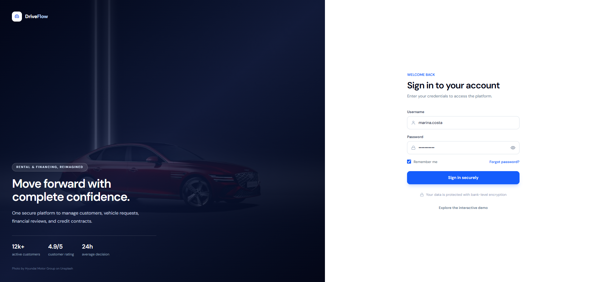
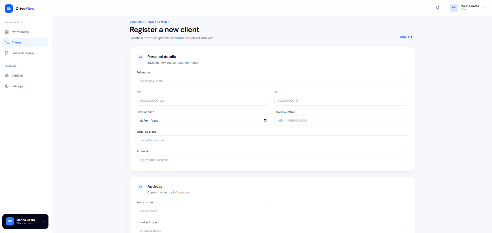
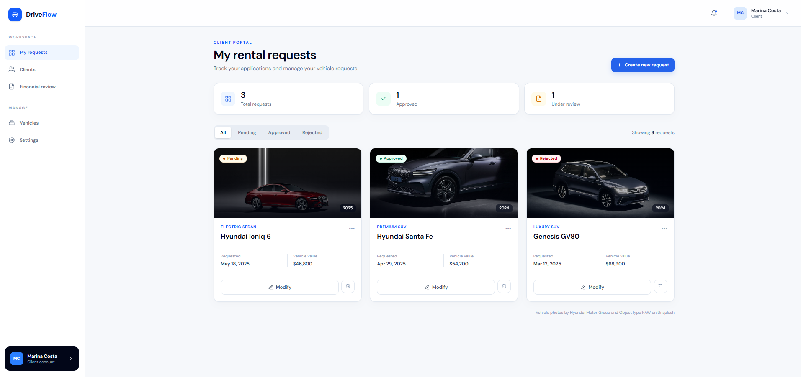
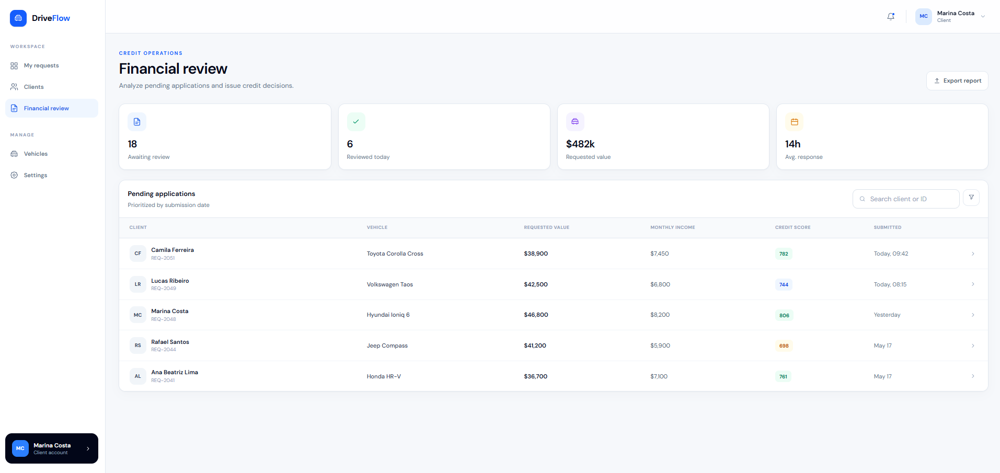

# Protótipo do Sistema de Aluguel de Carros

Este documento apresenta as interfaces principais do sistema, projetadas para atender aos requisitos de gestão de locação e avaliação de crédito.

**Link do Protótipo:** [Acessar Projeto no Figma](COLE_SEU_LINK_AQUI)

### 1. Tela de Login
Interface de autenticação obrigatória, garantindo o acesso restrito a clientes e agentes cadastrados.

### 2. Cadastro de Clientes (CRUD)
Formulário para registro de clientes, incluindo informações pessoais, de endereço e a capacidade de adicionar até 3 fontes de rendimento auferido.

### 3. Dashboard do Cliente (Meus Pedidos)
Visão centrada no usuário individual para introduzir novos pedidos, visualizar o status (pendente, aprovado, rejeitado) e modificar ou cancelar solicitações ativas.

### 4. Dashboard do Agente (Avaliação Financeira)
Visão administrativa onde empresas e bancos podem avaliar pedidos submetidos, emitir parecer financeiro e configurar os termos de um contrato de crédito (exclusivo para bancos).
